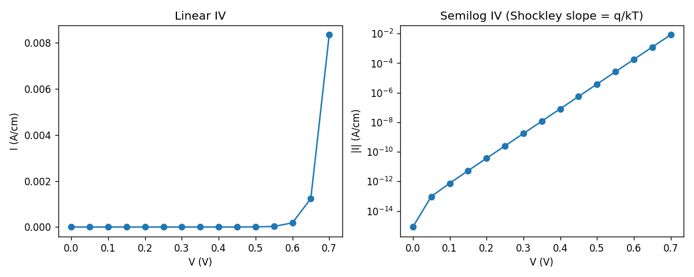

# 1. A p-n junction

You'll build a 1 µm × 1 µm silicon diode with Nₐ = N_d = 10¹⁷ cm⁻³, sweep it to
0.7 V forward bias, and look inside at the potential and carrier densities.

## Describe the structure

A `Structure` is a stack of layers, bottom first, across a width. Each layer has
a material and uniform doping. Contacts are spans on the top or bottom surface of
a layer.

```python
from opentcad.geometry.formats import Material
from opentcad.geometry.structure import Structure

diode = (Structure(width_um=1.0, name="pn_diode")
    .add_substrate("p", 0.5, Material.SI, doping_Na=1e17)
    .add_layer    ("n", 0.5, Material.SI, doping_Nd=1e17)
    .add_contact  ("anode",   0.0, 1.0, "p", surface="bottom")
    .add_contact  ("cathode", 0.0, 1.0, "n", surface="top"))
```

## Mesh it

`to_meshfield` triangulates the structure with Gmsh, refining at material
interfaces, and returns a `MeshField`. That is the object every later stage
reads.

```python
mesh = diode.to_meshfield(mesh_size_um=0.05)
print(mesh.summary())
```

## Solve and sweep

`DeviceSolver` needs the mesh and the parameters of each material in it.
`load_material("Si")` reads the cited silicon file. The default physics is
Boltzmann statistics, constant mobility and SRH recombination.

```python
from opentcad.device.solver import DeviceSolver
from opentcad.materials.database import load_material

solver = DeviceSolver(mesh, {"Silicon": load_material("Si")})
V, I = solver.iv_sweep("anode", "cathode", v_start=0.0, v_end=0.7, v_step=0.05)
```

`I` is the anode current per unit width, in A/cm. In forward bias, current
rises by a factor e for every kT/q ≈ 25.85 mV at 300 K, which is 59.5 mV per
decade. The diode has ideality 1 until high injection.



## Look inside

`solver.run("fields")` returns a copy of the mesh carrying `Potential`,
`Electrons` and `Holes`. Pass biases to see the device under bias:

```python
import numpy as np

at_zero = solver.run("fields")
forward = solver.field_snapshot({"anode": 0.4})
y = np.asarray(forward.points)[:, 1]
n = np.asarray(forward.grid.point_data["Electrons"])
p = np.asarray(forward.grid.point_data["Holes"])
ni = load_material("Si").band_structure.ni_cm3_300K
middle = np.abs(y - 0.5) < 0.05
print("n·p / n_i² at the junction:", np.median(n[middle] * p[middle]) / ni**2)
print("exp(V/V_t):                ", np.exp(0.4 / 0.025852))
solver.close()
```

The two printed numbers agree (the law of the junction). The
[visualization guide](../visualization.md) shows how to plot these fields.

## Check it

- **Script:** [`examples/01_pn_junction.py`](https://github.com/abhineet-agarwal/opentcad/blob/main/examples/01_pn_junction.py)
  adds plots and an ideality-factor fit against the Shockley equation.
- **Tests:** [`tests/device/test_pn_junction_integration.py`](https://github.com/abhineet-agarwal/opentcad/blob/main/tests/device/test_pn_junction_integration.py)
  checks the slope within 5 %, and [`tests/device/test_snapshot.py`](https://github.com/abhineet-agarwal/opentcad/blob/main/tests/device/test_snapshot.py)
  checks the potentials within 1 mV.

**Next:** [2. A MOS capacitor](02_mos_capacitor.md).
