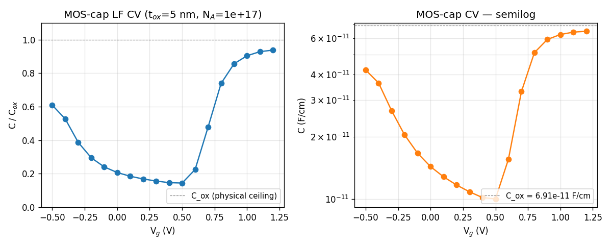

# 2. A MOS capacitor

You'll add an oxide and a gate, and measure capacitance against gate voltage.

## Insulators and gates

Put a 5 nm SiO₂ layer on p-type silicon and a contact on the oxide:

- **Interfaces:** OpenTCAD finds the Si/SiO₂ interface and keeps the potential
  continuous across it.
- **Insulators:** the oxide is solved for Poisson only, with no carriers.
- **Gates:** a contact on an insulator is treated as a metal gate.

```python
from opentcad.device.solver import DeviceSolver
from opentcad.geometry.formats import Material
from opentcad.geometry.structure import Structure
from opentcad.materials.database import load_material

mos = (Structure(width_um=1.0, name="mos_cap")
    .add_substrate("body",  0.5,   Material.SI,   doping_Na=1e17)
    .add_layer    ("oxide", 0.005, Material.SIO2)
    .add_contact  ("body",  0.0, 1.0, "body",  surface="bottom")
    .add_contact  ("gate",  0.0, 1.0, "oxide", surface="top"))

materials = {"Silicon": load_material("Si"), "SiO2": load_material("SiO2")}
solver = DeviceSolver(mos.to_meshfield(mesh_size_um=0.05), materials)
```

## Quasi-static C–V

`cv_sweep` steps the gate bias and differentiates the gate charge. This is the
low-frequency C–V:

- **Accumulation:** capacitance reaches C_ox.
- **Depletion:** capacitance falls as the depletion layer widens.
- **Inversion:** capacitance recovers as the inversion layer forms.

```python
V, C = solver.cv_sweep("gate", "body", v_start=-2.0, v_end=2.0, v_step=0.1)
solver.close()

eps0, eps_ox = 8.854e-14, 3.9                     # F/cm, SiO2
c_ox = eps0 * eps_ox / 0.005e-4                   # F/cm² for 5 nm
print(f"max C = {max(C):.3e} F/cm  (C_ox × 1 µm width = {c_ox * 1e-4:.3e} F/cm)")
print(f"min C / max C = {min(C) / max(C):.2f}")
```

C is per unit width (F/cm), so for this 1 µm wide device C_ox × 1 µm is the
accumulation value.



For **high-frequency** C–V, where the inversion layer can't follow the signal,
use small-signal AC:
- declare the terminal when building the solver, with `ac_terminals=["gate"]`;
- then call `ac_sweep`.

[`examples/11_mos_hfcv.py`](https://github.com/abhineet-agarwal/opentcad/blob/main/examples/11_mos_hfcv.py) does this.

## Gate work function and oxide charge

`add_contact(..., flat_band_shift_V=…)` offsets the gate by a flat-band voltage,
which combines the work-function difference, fixed oxide charge and mid-gap
interface traps into one number. A charge at a physical location is set instead
with `DeviceSolver(..., interface_Qf_C_per_cm2={"SI": (Qf, y_interface_um)})`.
See [Device physics](../device_physics.md#contacts).

## Check it

- **Script:** [`examples/03_mos_cv.py`](https://github.com/abhineet-agarwal/opentcad/blob/main/examples/03_mos_cv.py) plots this
  C–V.
- **Tests:**
  - [`tests/device/test_cv_sweep.py`](https://github.com/abhineet-agarwal/opentcad/blob/main/tests/device/test_cv_sweep.py)
    checks the approach to C_ox and the depletion dip.
  - [`tests/device/test_mos_capacitor.py`](https://github.com/abhineet-agarwal/opentcad/blob/main/tests/device/test_mos_capacitor.py)
    checks that the surface potential is near 2·φ_F in strong inversion.

**Next:** [3. An NMOS from a process recipe](03_nmos_from_recipe.md).
