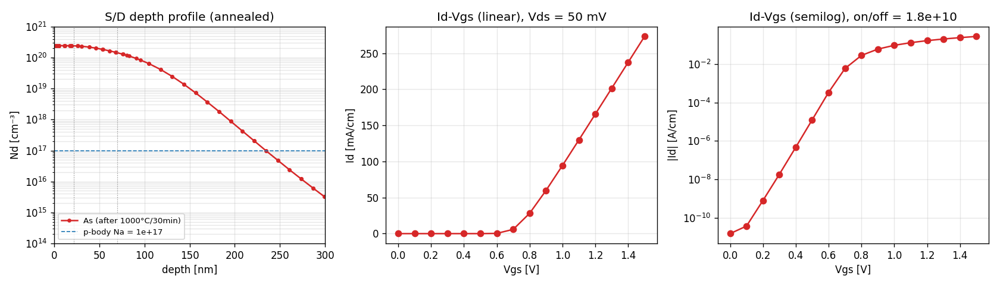

# 3. An NMOS from a process recipe

So far, doping has been painted onto layers. Now a **recipe** of process steps
puts it there: arsenic implants form the source and drain, and an anneal
diffuses them. You'll then sweep the transistor.

## The starting structure

The structure holds what exists before implantation:
- a p-type body with uniform doping;
- a 5 nm gate oxide;
- two silicon windows through the oxide, where the source and drain contacts
  will sit.

```python
from opentcad.geometry.formats import Material
from opentcad.geometry.structure import Structure

W, L, T_OX = 2.0, 1.0, 0.005
nmos = (Structure(width_um=W, name="nmos")
    .add_substrate("p_body", 0.5, Material.SI, doping_Na=1e17)
    .add_layer("oxide", T_OX, Material.SIO2)
    .add_region("src_win", 0.0, 0.5, 0.4, 0.5 + T_OX, Material.SI, doping_Na=1e17)
    .add_region("drn_win", W - 0.5, W, 0.4, 0.5 + T_OX, Material.SI, doping_Na=1e17)
    .add_contact("source", 0.0, 0.5, "oxide", surface="top")
    .add_contact("drain", W - 0.5, W, "oxide", surface="top")
    .add_contact("gate", 0.5, 0.5 + L, "oxide", surface="top")
    .add_contact("body", 0.0, W, "p_body", surface="bottom"))
```


A region replaces both the material and the doping beneath it. That's why the
windows repeat the body's `doping_Na`: without it they would be undoped.


## The recipe

```python
from opentcad.process.topography import Recipe

recipe = (Recipe("nmos_sd")
    .implant("As", 30, 1e15, window_x_um=(0.0, 0.5))      # species, keV, cm⁻²
    .implant("As", 30, 1e15, window_x_um=(W - 0.5, W))
    .anneal(1000, 1800))                                  # °C, s
print(recipe.summary())
```

Each implant uses a Pearson profile matched to tabulated range moments. Lateral
straggle blurs the mask edges. The species and energy are checked when the step
is created: an unknown species or an energy outside the 10–200 keV table is an
error at this point, not later.

## Run it

`run_recipe` builds the device mesh and applies the steps in order. The result's
`meshfield` carries the totals `Nd` and `Na`, plus `C_arsenic` for the
implanted species.

```python
from opentcad.process import run_recipe

out = run_recipe(nmos, recipe, mesh_size_um=0.03)
mf = out.meshfield
print(mf.species_names(), f"peak As = {mf.get_species('arsenic').max():.2e} cm⁻³")
```

## Sweep the transistor

Hold the drain at 50 mV, sweep the gate and read the drain current:

```python
from opentcad.device.extract import vth_constant_current
from opentcad.device.solver import DeviceSolver
from opentcad.materials.database import load_material

solver = DeviceSolver(mf, {"Silicon": load_material("Si"), "SiO2": load_material("SiO2")})
Vg, Id = solver.iv_sweep("gate", "source", v_start=0.0, v_end=1.5, v_step=0.1,
                         hold_contacts={"drain": 0.05}, measure_contact="drain")
solver.close()
ids = [abs(i) for i in Id]
print(f"on/off = {max(ids) / min(ids):.1e}")
print(f"Vth (100 nA·W/L) = {vth_constant_current(Vg, ids, 1e-7 * 1e4 / L):.2f} V")
```

The constant-current threshold uses I_crit = 100 nA × W/L. The current here is
per unit width in A/cm, so I_crit = 10⁻⁷ A × 10⁴ cm⁻¹ / L[µm]. On/off is about
10¹⁰.



## The same run as a file

This device is the bundled simulation file
[`examples/decks/nmos_implanted.yaml`](https://github.com/abhineet-agarwal/opentcad/blob/main/examples/decks/nmos_implanted.yaml).
[`examples/decks/nmos_tox_sweep.yaml`](https://github.com/abhineet-agarwal/opentcad/blob/main/examples/decks/nmos_tox_sweep.yaml)
sweeps its oxide thickness and extracts Vth at each point:

```bash
opentcad sweep examples/decks/nmos_tox_sweep.yaml -j 3
```

## Check it

- **Script:** [`examples/06_nmos_implanted.py`](https://github.com/abhineet-agarwal/opentcad/blob/main/examples/06_nmos_implanted.py)
  plots the doping and Id–Vgs.
- **Hand-doped version:** [`examples/02_nmos_idvg.py`](https://github.com/abhineet-agarwal/opentcad/blob/main/examples/02_nmos_idvg.py).
- **SKY130 check:** a 1 µm device of this kind, built with SkyWater's oxide and
  junction depth, reproduces SkyWater's threshold within 15 %. See
  [Validation](../validation.md#the-sky130-nmos-threshold-check-phase-2-exit).

**Next:** [4. A trench from a masked etch](04_masked_etch.md).
