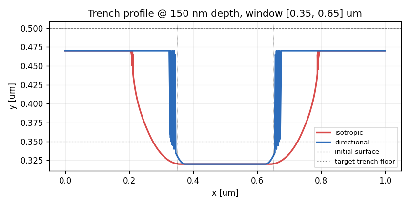

# 4. A trench from a masked etch

Topography steps (deposit, etch, oxidize) change the *shape* of the device. They
run on ViennaLS level sets, so this tutorial needs the `topography` extra:
`pip install -e ".[topography]"`.

## An isotropic etch through a mask

Start with bare silicon. Etch 30 nm everywhere, then etch 150 nm isotropically
through a 300 nm mask window. An isotropic etch undercuts the mask, which gives
the quarter-circle profile.

```python
from opentcad.geometry.formats import Material
from opentcad.geometry.structure import Structure
from opentcad.process import run_recipe
from opentcad.process.topography import Recipe

struct = (Structure(width_um=1.0, name="trench")
    .add_substrate("body", 0.5, Material.SI, doping_Na=1e16)
    .add_contact("bulk", 0.0, 1.0, "body", surface="bottom"))

recipe = (Recipe("curved_trench")
    .etch(0.03)                                   # blanket
    .etch(0.15, window_x_um=(0.35, 0.65)))        # through the mask window

out = run_recipe(struct, recipe, grid_delta_um=0.005, mesh_size_um=0.03)
mf = out.meshfield
print(out.topography_state.top.material.name, mf.summary())
```

- `grid_delta_um` is the level-set resolution.
- `mesh_size_um` is the element size of the device mesh built from the result.

The structure's doping and contacts carry over to the processed mesh:
- the silicon left after etching keeps its doping;
- the bottom contact stays on the wafer floor.

The rules are in [Process simulation](../process.md#from-structure-to-processed-device).

## Directional etch and selectivity

```python
rie = Recipe("rie").etch(0.15, model="directional", window_x_um=(0.35, 0.65))
mixed = Recipe("mixed").etch(0.15, model="directional", sidewall_ratio=0.4,
                             window_x_um=(0.35, 0.65))
```

- `model="directional"` gives near-vertical walls.
- `sidewall_ratio` adds a chemical, isotropic component.
- On a stack, `rates={Material.SI3N4: 1.0, Material.SIO2: 0.02}` gives each
  material its own etch rate. That's a nitride etch that stops on oxide.




These are **geometric** models: they evolve the shape at a prescribed rate, with
no plasma chemistry or ion flux. They are good for building realistic device
shapes, not for predicting a particular tool's etch profile.


## Check it

- **Script:** [`examples/04_topography_hello.py`](https://github.com/abhineet-agarwal/opentcad/blob/main/examples/04_topography_hello.py)
  compares the isotropic and directional profiles and runs a hardmask
  through-etch.
- **Tests:** [`tests/process/test_topography_smoke.py`](https://github.com/abhineet-agarwal/opentcad/blob/main/tests/process/test_topography_smoke.py)
  and [`tests/process/test_selectivity.py`](https://github.com/abhineet-agarwal/opentcad/blob/main/tests/process/test_selectivity.py).

**Next:** [5. LOCOS field isolation](05_locos.md).
