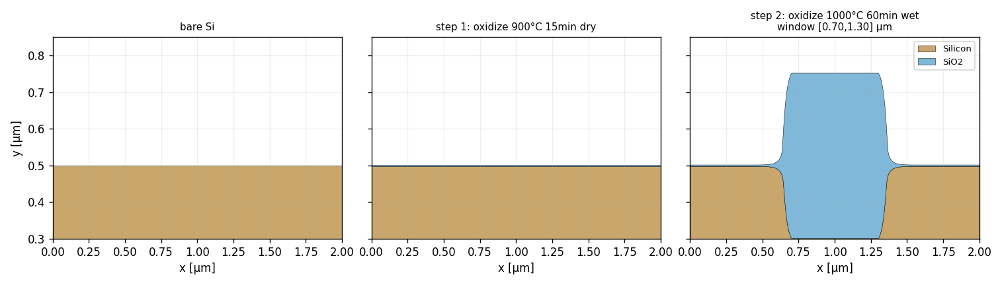

# 5. LOCOS field isolation

Thermal oxidation consumes silicon and grows oxide. Masking it locally (LOCOS)
gives thick field oxide between devices, tapering into a "bird's beak" under the
mask edge. This tutorial needs the `topography` extra.

## Deal–Grove oxidation

`oxidize` follows the linear-parabolic law x² + A·x = B(t + τ), with Arrhenius A
and B for dry O₂ and wet H₂O on ⟨100⟩ silicon. In each column, the silicon surface
moves down by 0.44·Δx and the oxide top moves up by 0.56·Δx.

```python
from opentcad.geometry.formats import Material
from opentcad.geometry.structure import Structure
from opentcad.process import run_recipe
from opentcad.process.topography import Recipe, simulate

wafer = (Structure(width_um=2.0, name="locos")
    .add_substrate("body", 1.0, Material.SI, doping_Na=1e16)
    .add_layer("pad", 0.01, Material.SIO2))                 # 10 nm pad oxide

import numpy as np
from opentcad.process.topography import extract_surface_polyline
from opentcad.process.topography.oxidation import oxide_thickness

def surface_y_um(layer):
    nodes, _ = extract_surface_polyline(layer.level_set)
    return float(np.median(np.asarray(nodes)[:, 1]))

blanket = Recipe("dry").oxidize(temperature_C=1000, time_s=1800, ambient="dry")
state = simulate(wafer, blanket, grid_delta_um=0.005)
si, ox = state.layers[0], state.layers[-1]
simulated = surface_y_um(ox) - surface_y_um(si)
analytic = oxide_thickness(0.01, 1800, 1000 + 273.15, "dry")
print(f"oxide after 30 min dry at 1000 °C: {simulated * 1e3:.1f} nm "
      f"(Deal–Grove: {analytic * 1e3:.1f} nm)")
```

## Masked oxidation

A `window_x_um` limits growth to the nitride-mask opening.
`bird_beak_length_um` sets how far growth feathers under the mask edge.

```python
locos = Recipe("locos").oxidize(temperature_C=1000, time_s=3600, ambient="wet",
                                window_x_um=(0.7, 1.3), bird_beak_length_um=0.03)
mf = run_recipe(wafer, locos, grid_delta_um=0.005, mesh_size_um=0.05).meshfield
print(mf.summary())
```




The bird's beak is a heuristic exponential feathering, not 2-D oxidant diffusion
under the nitride. The oxide thickness away from the mask edges follows
Deal–Grove.


## Check it

- **Script:** [`examples/05_locos.py`](https://github.com/abhineet-agarwal/opentcad/blob/main/examples/05_locos.py) runs the full
  flow and plots the stack and mesh.
- **Tests:** [`tests/process/test_oxidation.py`](https://github.com/abhineet-agarwal/opentcad/blob/main/tests/process/test_oxidation.py)
  checks:
  - the oxide thickness against analytic Deal–Grove, within 5 % at 1000–1100 °C,
    dry and wet;
  - the LOCOS centre, the untouched masked regions and the bird's beak.

**Next:** the [example gallery](examples.md), or the [user guide](../concepts.md).
