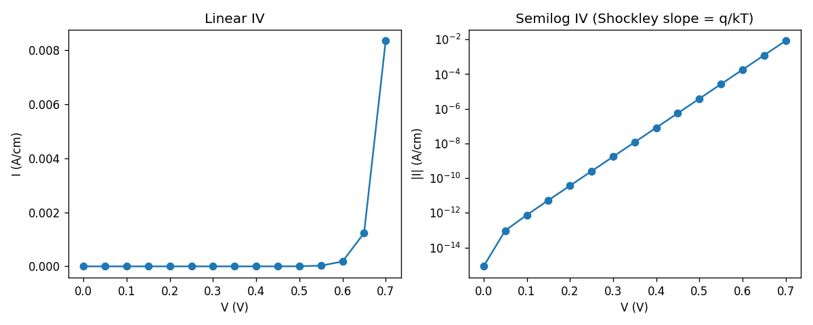
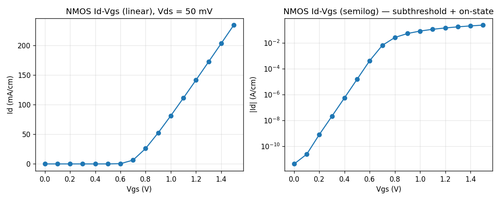
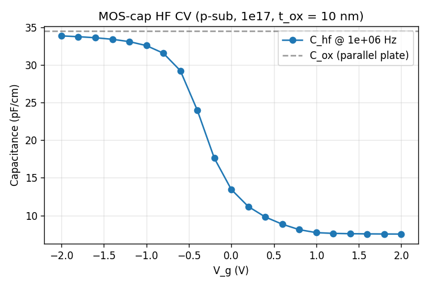
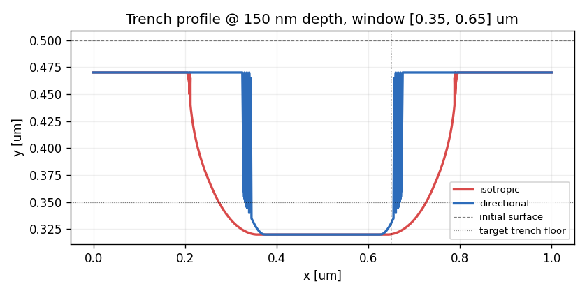
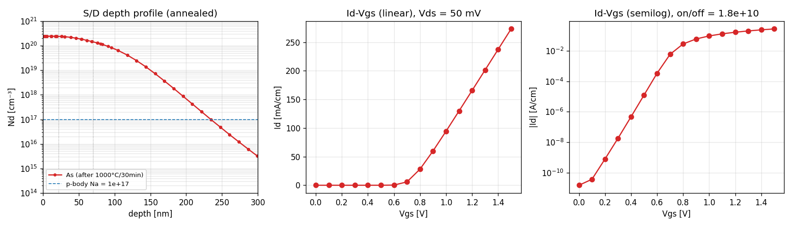
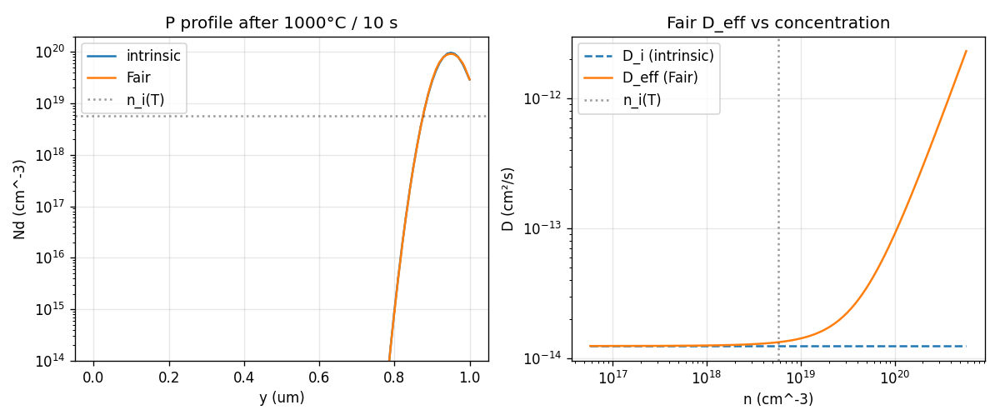

# Example gallery

Complete scripts in [`examples/`](https://github.com/abhineet-agarwal/opentcad/tree/main/examples). Run them from the repository
root, for example `python examples/01_pn_junction.py`; each writes its figures
next to itself.

## Devices

| Example | What it shows |
|---|---|
| [`01_pn_junction.py`](https://github.com/abhineet-agarwal/opentcad/blob/main/examples/01_pn_junction.py) | Diode I–V with an ideality-factor fit against Shockley |
| [`02_nmos_idvg.py`](https://github.com/abhineet-agarwal/opentcad/blob/main/examples/02_nmos_idvg.py) | Hand-doped 2-D NMOS, Id–Vgs at V_ds = 50 mV |
| [`03_mos_cv.py`](https://github.com/abhineet-agarwal/opentcad/blob/main/examples/03_mos_cv.py) | Quasi-static C–V of a MOS capacitor |
| [`10_pn_transient.py`](https://github.com/abhineet-agarwal/opentcad/blob/main/examples/10_pn_transient.py) | Transient turn-on of a diode driven 0.1 → 0.7 V in 10 ns (`transient_sweep`) |
| [`11_mos_hfcv.py`](https://github.com/abhineet-agarwal/opentcad/blob/main/examples/11_mos_hfcv.py) | High-frequency C–V at 1 MHz via small-signal AC (`ac_sweep`) |

## Process

| Example | What it shows |
|---|---|
| [`04_topography_hello.py`](https://github.com/abhineet-agarwal/opentcad/blob/main/examples/04_topography_hello.py) | Isotropic vs directional etch through a mask; a hardmask through-etch |
| [`05_locos.py`](https://github.com/abhineet-agarwal/opentcad/blob/main/examples/05_locos.py) | Pad oxide then masked wet oxidation: LOCOS with a bird's beak |
| [`06_nmos_implanted.py`](https://github.com/abhineet-agarwal/opentcad/blob/main/examples/06_nmos_implanted.py) | NMOS whose source and drain come from implants and an anneal |
| [`09_fair_anneal_profile.py`](https://github.com/abhineet-agarwal/opentcad/blob/main/examples/09_fair_anneal_profile.py) | Fair concentration-coupled diffusion vs intrinsic, at 10²⁰ cm⁻³ phosphorus |

## Photovoltaics

| Example | What it shows |
|---|---|
| [`07_photovoltaic.py`](https://github.com/abhineet-agarwal/opentcad/blob/main/examples/07_photovoltaic.py) | Dark and illuminated I–V of a diode with prescribed Beer–Lambert generation |
| [`08_pv_compact.py`](https://github.com/abhineet-agarwal/opentcad/blob/main/examples/08_pv_compact.py) | Fitting a single-diode model, the maximum-power point and SPICE export, on synthetic data |

See [Optical generation](../optical_generation.md) and
[Compact PV model](../photovoltaic_compact.md).

## Simulation files and records

| Folder | Contents |
|---|---|
| [`examples/decks/`](https://github.com/abhineet-agarwal/opentcad/tree/main/examples/decks) | `pn_diode.yaml`, `nmos_implanted.yaml` and the oxide sweep `nmos_tox_sweep.yaml` |
| [`examples/catalog/`](https://github.com/abhineet-agarwal/opentcad/blob/main/examples/catalog/README.md) | Process-catalog records: equipment, a resist, a split process flow |
| [`validation/sky130/`](https://github.com/abhineet-agarwal/opentcad/blob/main/validation/sky130/README.md) | The SKY130 NMOS threshold check |
