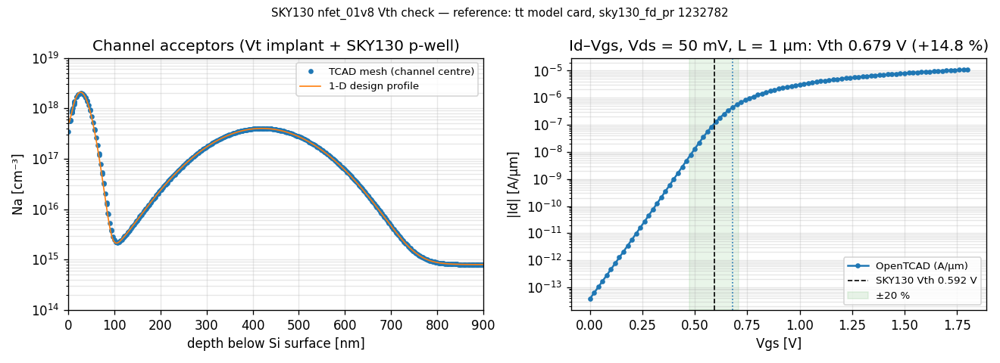

# SKY130 nfet_01v8 Vth check (Phase 2 exit criterion)

A 1 µm NMOS is built from a process recipe and simulated with DEVSIM. Its
threshold voltage is then compared with SkyWater's own `nfet_01v8` model
card, using the same extraction on both curves. Pass: within 20 %.

```
python -m validation.sky130.vth_check            # runs the check, writes vth_check.png
python -m validation.sky130.extract_reference    # regenerates the reference (needs ngspice + PDK)
pytest tests/validation -v                       # design tests + the slow end-to-end check
```

## Reference

`nfet_01v8_tt_reference.json` comes from `extract_reference.py`. That script
runs the SKY130 typical-corner BSIM4 model card in ngspice 44.2 at
W = 10 µm and 26.85 °C (300 K, the device solver's temperature), with body
and source grounded. The PDK is open_pdks `b01f6d28` with sky130_fd_pr
`1232782c`. The BSIM `vth0` parameter is a per-bin fit constant
(−3.2 … 5.0 V across bins), not a physical threshold, so the reference is
extracted from simulated curves instead.

| L | Vth, max-gm (V) | Vth, 100 nA·W/L (V) | DIBL (mV/V) | SS (mV/dec) |
|---|---|---|---|---|
| 0.15 µm | 0.711 | 0.659 | 49 | 77 |
| 0.5 µm | 0.627 | 0.580 | 15 | 86 |
| **1 µm** | **0.592** | **0.547** | 10 | 85 |
| 20 µm | 0.543 | 0.500 | 7 | 85 |

Vth rises at short L because SKY130 uses pocket implants, which this check
leaves out. The comparison is therefore made at L = 1 µm, where short-channel
effects are small.

## Inputs

**From SkyWater:**

- Gate oxide 4.148 nm: `toxe` of the tt model card, the same in all 180 bins.
- P-well N(y) = 4×10¹⁷·exp(−((y − 0.42 µm)/0.13 µm)²) cm⁻³ on an
  8×10¹⁴ cm⁻³ background. These are the SKY130 design criteria in
  skywater-pdk `docs/rules/assumptions.rst`, Table 3a (PWPCONC, PWPCOORD,
  PWYCHAR, NWBCONC). Read this way, the well falls back to the background at
  0.75 µm, the p-well depth in Table 3b (PWVDIM). That agreement checks the
  reading. The profile is placed as the final well, after the recipe.
- S/D junction depth 0.1 µm (Table 3b, JCTD). The S/D implant energy is
  chosen to land there.

**Stand-ins (SkyWater doesn't publish these):**

- Threshold-adjust implant: boron at 10 keV. Its dose is sized once with the
  1-D depletion-approximation formula in `vth_check.long_channel_vth`, so that
  the design Vth equals the 0.592 V reference. The 2-D simulation then runs
  untuned.
- S/D: arsenic at 2×10¹⁵ cm⁻². Anneal: 1000 °C for 10 s (intrinsic model).
- n+ poly gate, taken as degenerate (φ_m = χ_Si). Poly depletion and quantum
  confinement are not modelled.
- Device physics: Lombardi surface mobility over Klaassen, SRH, Boltzmann
  statistics, no bandgap narrowing; 300 K.

## What passing means

The process-to-device chain (Pearson implants, anneal, 2-D drift-diffusion,
Vth extraction) agrees with first-order design and lands in SkyWater's range.
It does not show that OpenTCAD predicts SkyWater's actual, unpublished
process: the threshold implant was sized to the target.

## Result

**Pass.** At L = 1 µm and Vds = 50 mV:

| | OpenTCAD | SKY130 | Difference |
|---|---|---|---|
| Vth, max-gm | 0.679 V | 0.592 V | +14.8 % |
| Vth, 100 nA·W/L | 0.588 V | 0.547 V | +7.5 % |
| S/D junction depth | 100.3 nm | 100 nm | +0.3 % |



Design: n+ poly flat-band shift −0.564 V. Threshold implant boron at
10 keV, 7.78×10¹² cm⁻². S/D arsenic at 25.7 keV, 2×10¹⁵ cm⁻². The design
Vth is 0.592 V by construction.

**Mesh refinement.** The bulk element size is given; DSL meshing halves it at
the Si/SiO₂ interface.

| Mesh | Vth, max-gm | Vth, 100 nA·W/L | Junction depth |
|---|---|---|---|
| 20 nm | — (gm still rising at 1.8 V) | 0.567 V | 101.8 nm |
| **10 nm (default)** | **0.679 V** | **0.588 V** | **100.3 nm** |
| 7 nm | 0.671 V | 0.590 V | 100.4 nm |

**Caveat on max-gm.** The simulated gm rises to a flat plateau instead of
peaking. At 10 nm its maximum (near 1.6 V) is only 0.1 % above the neighbouring
points. At 7 nm the peak is clearer, near 1.45 V. Tangents drawn anywhere on the
plateau give 0.65–0.68 V, so the max-gm number is less robust than the
constant-current one. The cause is mobility, not the doping or the
electrostatics. Lombardi with its literature (Darwish 1997) coefficients rolls
the surface mobility off only mildly at this channel doping, while SkyWater's
BSIM card has a clear gm peak. Our peak gm is also about 25 % below SKY130's
(0.102 vs 0.137 S/cm). Fitting the mobility is Phase 3 calibration.
