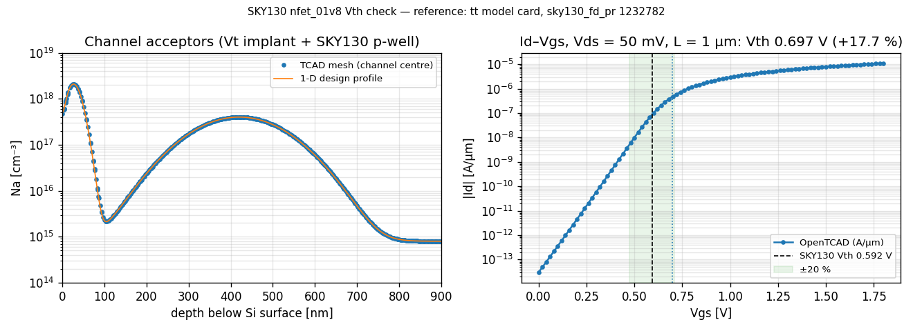

# SKY130 nfet_01v8 Vth check (Phase 2 exit criterion)

A 1 µm NMOS is built from a process recipe and simulated with DEVSIM. Its
threshold voltage is then compared with SkyWater's own `nfet_01v8` model
card, using the same extraction on both curves. Pass: within 20 %.

```
python -m validation.sky130.vth_check            # runs the check, writes vth_check.png
python -m validation.sky130.extract_reference    # regenerates the reference (needs ngspice + PDK)
pytest tests/validation -v                       # design tests + the slow end-to-end check
```

## Reference

`nfet_01v8_tt_reference.json` comes from `extract_reference.py`. That script
runs the SKY130 typical-corner BSIM4 model card in ngspice 44.2 at
W = 10 µm and 26.85 °C (300 K, the device solver's temperature), with body
and source grounded. The PDK is open_pdks `b01f6d28` with sky130_fd_pr
`1232782c`. The BSIM `vth0` parameter is a per-bin fit constant
(−3.2 … 5.0 V across bins), not a physical threshold, so the reference is
extracted from simulated curves instead.

| L | Vth, max-gm (V) | Vth, 100 nA·W/L (V) | DIBL (mV/V) | SS (mV/dec) |
|---|---|---|---|---|
| 0.15 µm | 0.711 | 0.659 | 49 | 77 |
| 0.5 µm | 0.627 | 0.580 | 15 | 86 |
| **1 µm** | **0.592** | **0.547** | 10 | 85 |
| 20 µm | 0.543 | 0.500 | 7 | 85 |

Vth rises at short L because SKY130 uses pocket implants, which this check
leaves out. The comparison is therefore made at L = 1 µm, where short-channel
effects are small.

## Inputs

**From SkyWater:**

- Gate oxide 4.148 nm: `toxe` of the tt model card, the same in all 180 bins.
- P-well N(y) = 4×10¹⁷·exp(−((y − 0.42 µm)/0.13 µm)²) cm⁻³ on an
  8×10¹⁴ cm⁻³ background. These are the SKY130 design criteria in
  skywater-pdk `docs/rules/assumptions.rst`, Table 3a (PWPCONC, PWPCOORD,
  PWYCHAR, NWBCONC). Read this way, the well falls back to the background at
  0.75 µm, the p-well depth in Table 3b (PWVDIM). That agreement checks the
  reading. The profile is placed as the final well, after the recipe.
- S/D junction depth 0.1 µm (Table 3b, JCTD). The S/D implant energy is
  chosen to land there.

**Stand-ins (SkyWater doesn't publish these):**

- Threshold-adjust implant: boron at 10 keV. Its dose is sized once with the
  1-D depletion-approximation formula in `vth_check.long_channel_vth`, so that
  the design Vth equals the 0.592 V reference. The 2-D simulation then runs
  untuned.
- S/D: arsenic at 2×10¹⁵ cm⁻². Anneal: 1000 °C for 10 s (intrinsic model).
- n+ poly gate, taken as degenerate (φ_m = χ_Si). Poly depletion and quantum
  confinement are not modelled.
- Device physics: Lombardi surface mobility over Klaassen, SRH, Boltzmann
  statistics, no bandgap narrowing; 300 K.

## What passing means

The process-to-device chain (Pearson implants, anneal, 2-D drift-diffusion,
Vth extraction) agrees with first-order design and lands in SkyWater's range.
It does not show that OpenTCAD predicts SkyWater's actual, unpublished
process: the threshold implant was sized to the target.

## Result

**Pass.** At L = 1 µm and Vds = 50 mV:

| | OpenTCAD | SKY130 | Difference |
|---|---|---|---|
| Vth, max-gm | 0.697 V | 0.592 V | +17.7 % |
| Vth, 100 nA·W/L | 0.599 V | 0.547 V | +9.6 % |
| S/D junction depth | 99.9 nm | 100 nm | −0.1 % |

These numbers changed when anneals stopped carrying boron into the gate
oxide (see CHANGELOG). Before, the surface boron was 3.5×10¹⁷ cm⁻³ instead of
the design's 5.0×10¹⁷ (now 4.8×10¹⁷), and the thresholds were 0.679 V and
0.588 V.



Design: n+ poly flat-band shift −0.564 V. Threshold implant boron at
10 keV, 7.78×10¹² cm⁻². S/D arsenic at 25.7 keV, 2×10¹⁵ cm⁻². The design
Vth is 0.592 V by construction.

**Mesh refinement.** The bulk element size is given; DSL meshing halves it at
the Si/SiO₂ interface.

| Mesh | Vth, max-gm | Vth, 100 nA·W/L | Junction depth |
|---|---|---|---|
| 20 nm | — (gm still rising at 1.8 V) | 0.575 V | 99.8 nm |
| **10 nm (default)** | **0.697 V** | **0.599 V** | **99.9 nm** |
| 7 nm | 0.687 V | 0.601 V | 100.2 nm |

**Caveat on max-gm.** The simulated gm rises to a flat plateau instead of
peaking: at 10 nm its maximum is at 1.64 V, against SkyWater's 0.82 V. So the
max-gm number is less robust than the constant-current one. The cause is
mobility, not the doping or the electrostatics: Lombardi with its literature
(Darwish 1997) coefficients rolls the surface mobility off only mildly at this
channel doping, while SkyWater's BSIM card has a clear gm peak. Our peak gm is
also 26 % below SKY130's (10.2 vs 13.7 µS/µm). The Phase 3 calibration below
addresses both.

## Calibration (Phase 3)

`calibrate.py` calibrates the same 1 µm device against SkyWater's model card in
two stages: electrostatics first, then surface mobility. Results go to
`calibration.json`; the fitted mobility goes to a material file,
`materials/sky130/Si.yaml`.

```
python -m validation.sky130.calibrate electrostatics   # stand-in implant from the body effect
python -m validation.sky130.calibrate sensitivity      # which mobility coefficients act differently
python -m validation.sky130.calibrate scan             # a coarse grid far from the literature values
python -m validation.sky130.calibrate mobility         # least squares, from the best scan point
python -m validation.sky130.calibrate report           # every metric, before and after
pytest tests/validation/test_sky130_calibration.py
```

`extract_reference.py` also writes the targets: the Id–Vgs curves
(`nfet_01v8_tt_curves.json`), and the constant-current threshold at five body
biases (the `body_effect` table in `nfet_01v8_tt_reference.json`).

### Stage 1: electrostatics

The Phase 2 stand-in matches the zero-bias threshold by construction, but its
body effect is twice SkyWater's. Its boron peaks at 2×10¹⁸ cm⁻³ 30 nm down,
just inside the depletion region, so reverse body bias uncovers a lot of
charge. The body effect depends on the depletion charge and not on mobility,
so it pins the channel profile before any mobility is fitted.

Fitted: the dose of the stand-in boron implant (still 10 keV, the shallowest
the tables cover) and a drive-in at 1000 °C before the S/D implants. The fit
uses the 1-D depletion approximation, then is checked in 2-D. The two agree
within 5 mV. The dose and drive-in are correlated (0.93) but separable.

| Vbs | 0 | −0.45 V | −0.9 V | −1.35 V | −1.8 V |
|---|---|---|---|---|---|
| SkyWater, Vth (100 nA·W/L) | 0.547 | 0.645 | 0.725 | 0.793 | 0.853 |
| Phase 2 stand-in | 0.599 | 0.791 | 0.955 | 1.098 | 1.223 |
| Calibrated | 0.510 | 0.635 | 0.734 | 0.808 | 0.857 |

The calibrated implant is boron at 10 keV, 4.99×10¹² cm⁻², driven in for
204 s at 1000 °C. It gives a channel flat at about 8×10¹⁷ cm⁻³ for the first
30 nm, falling to 1.5×10¹⁷ by 80 nm. The S/D arsenic energy is re-designed for
the 0.1 µm junction (32.2 keV). The rms error over the five biases drops from
248 mV to 19 mV. Two parameters can't follow SkyWater's curvature exactly: the
zero-bias threshold ends up 37 mV (6.7 %) low, and the body effect at −1.8 V
13 % high (0.346 V against 0.306 V; the Phase 2 stand-in's is 0.624 V).

This doesn't recover SkyWater's real implant. It is one profile, of the
stand-in's form, that reproduces SkyWater's threshold and body effect.

### Stage 2: surface mobility

The Lombardi electron coefficients are fitted to SkyWater's linear Id–Vgs
(Vds = 50 mV). The residuals are relative current differences at equal gate
overdrive, 0.10 to 1.10 V above each curve's own constant-current threshold,
so the leftover threshold difference doesn't leak into the mobility.

- **Sensitivity.** At the literature values every coefficient moves the curve
  in the same shape (cosine similarity 1.000), so locally the curve fixes
  only one combination of them: an overall scale.
- **Scan.** Far from the literature values the coefficients do act
  differently. With phonon scattering weakened (`C_e` up) and surface roughness
  strengthened (`delta_e` down), the rms falls from 0.244 to 0.125 on a coarse
  grid.
- **Fit.** Least squares over `C_e`, `delta_e` and `A_e`, from the best grid
  point, reaches rms 0.091 after 37 simulations. It stopped at its evaluation
  limit, still creeping along a valley: `delta_e` and `A_e` are correlated at
  0.998.

| | Literature | Fitted |
|---|---|---|
| `C_e` | 1.70×10⁴ | 4.17×10⁵ |
| `delta_e` | 3.58×10¹⁸ | 5.94×10¹⁷ |
| `A_e` | 2.58 | 2.594 |

**What the fit means.** `C_e` at 24× its literature value all but removes
acoustic-phonon scattering, which is not physical. The fit is using it to
compensate for something the model gets wrong. The remaining error is
systematic, not noise: −15 % at 0.2 V overdrive, rising steadily to +12 % at
1.1 V. Lombardi on top of Klaassen can't produce SkyWater's mobility versus
field at this channel doping (about 8×10¹⁷ cm⁻³ at the surface). The likely
missing piece is Coulomb scattering screened by the inversion layer, which a
bulk model applied at the surface underestimates near threshold. So
`materials/sky130/Si.yaml` is the best fit these coefficients allow, labelled
as effective values. It is not a physical calibration of surface mobility.

### Result

L = 1 µm, against SkyWater's tt model card. "Electrostatics" is the device
after stage 1 with literature mobility; "calibrated" adds the fitted mobility.
Ion is at Vgs = Vds = 1.8 V with Canali velocity saturation driven by the
quasi-Fermi gradient (Canali's default).

| | Phase 2 stand-in | Electrostatics | Calibrated | SkyWater |
|---|---|---|---|---|
| Vth, max-gm (50 mV) | 0.697 V (+17.7 %) | 0.592 V (0.0 %) | 0.591 V (−0.1 %) | 0.592 V |
| Vth, 100 nA·W/L (50 mV) | 0.599 V (+9.6 %) | 0.510 V (−6.8 %) | 0.499 V (−8.8 %) | 0.547 V |
| Subthreshold swing | 89.0 (+5.0 %) | 80.4 (−5.1 %) | 80.9 (−4.5 %) | 84.7 mV/dec |
| Peak gm (50 mV) | 10.2 (−25.7 %) | 10.6 (−22.3 %) | 14.3 (+4.3 %) | 13.7 µS/µm |
| Vgs at peak gm | 1.64 V | 1.20 V | 1.08 V | 0.82 V |
| Ion | 84.5 (−39.5 %) | 116.7 (−16.4 %) | 134.5 (−3.6 %) | 139.6 µA/µm |
| Linear Id–Vgs, rms vs SkyWater | 0.296 | 0.247 | 0.092 | — |

Against the Phase 3 exit criterion (Vth, Ion and SS within 10 %), all three
pass for the calibrated device. The saturation threshold at 100 nA·W/L is
0.489 V against 0.529 V (−7.5 %).

**Ion and Canali's driving force.** Canali used to drive velocity saturation
with the electric field along each mesh edge. Ion was then 86.5 µA/µm before
the mobility fit and 86.7 after, so it didn't respond to mobility at all.
Without velocity saturation the calibrated device gives 156 µA/µm, so Canali cut
the current by a factor of 1.8. A long-channel estimate for 1 µm at these fields
gives about 1.2–1.4, and SkyWater's 139.6 µA/µm implies 1.1. The cause: in an
inversion layer on a triangular mesh, oblique edges also see the large vertical
gate field, so velocity saturation clamped their mobility even where the current
is low-field. Canali now uses the quasi-Fermi-potential gradient by default.
Across an inversion layer the quasi-Fermi level is flat, so only the field
driving the current counts. Ion becomes 134.5 µA/µm, the factor 1.16, and it
follows the mobility fit (116.7 → 134.5 µA/µm).

Where carrier densities are far below a reference density (`density_ref_cm3`,
default 10¹⁵ cm⁻³) the force tends to the electric field. Without that offset,
minority carriers that fall by orders of magnitude over the last mesh edge
before an ohmic contact see a large quasi-Fermi step, and a forward p-n diode's
current halves. The reference is a numerical choice: 10¹⁴ and 10¹⁶ give Ion
134.7 and 132.4 µA/µm (−3.5 % and −5.2 %).
